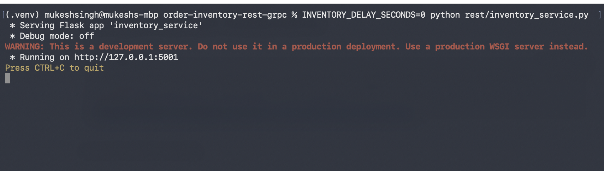
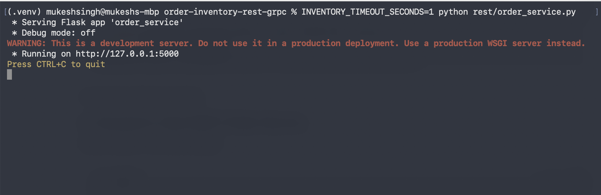
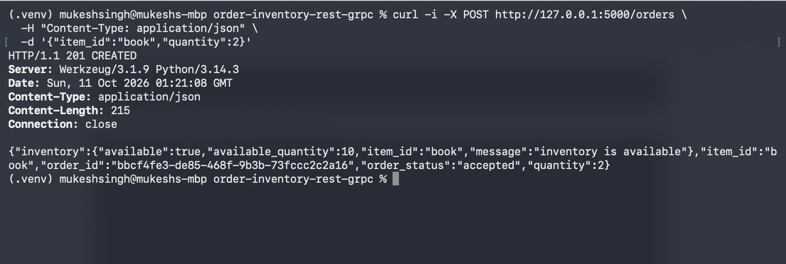
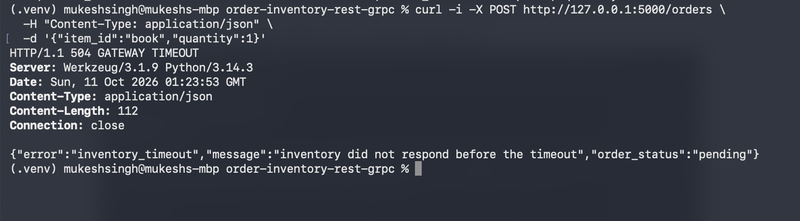
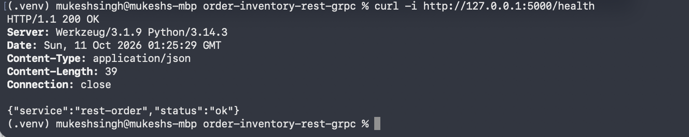
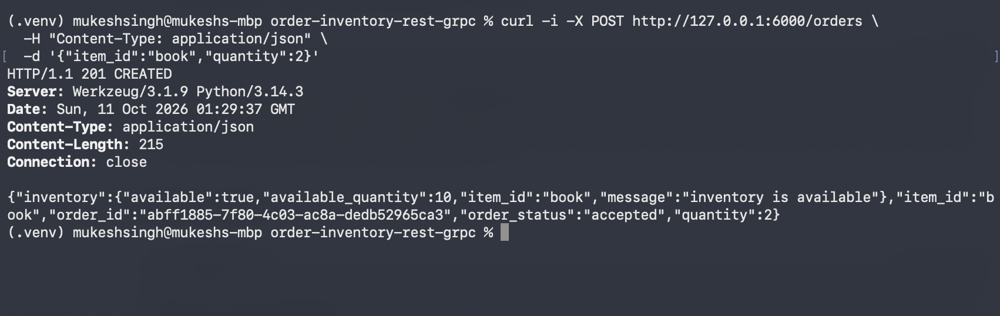
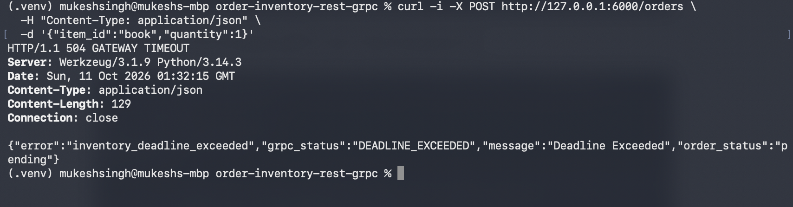
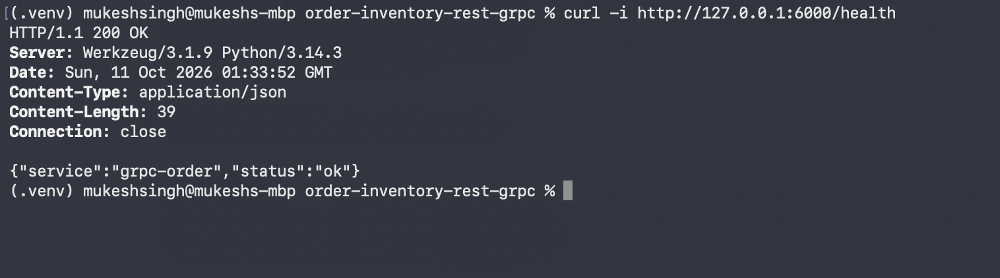

# Order and Inventory Service Communication with REST and gRPC

This project implements the same Order-to-Inventory interaction twice. In the REST version, the Order Service sends a JSON request to an HTTP inventory endpoint. In the gRPC version, the Order Service calls the `CheckInventory` RPC defined in `inventory.proto`. Both implementations enforce a one-second call limit, return clear unavailable-inventory errors, preserve an uncertain order as `pending` after a timeout, and remain available after Inventory responds too slowly.

## Architecture

```text
REST version
Client --HTTP/JSON--> Order Service :5000 --HTTP/JSON--> Inventory Service :5001

gRPC version
Client --HTTP/JSON--> Order Service :6000 --gRPC/Protobuf--> Inventory Service :50051
```

The HTTP endpoint on each Order Service is the client-facing entry point. The protocol being compared is the internal Order-to-Inventory call.

## Project structure

```text
.
├── README.md
├── demo.py
├── evidence
│   └── README.md
├── generate_grpc.py
├── requirements.txt
├── rest
│   ├── inventory_service.py
│   └── order_service.py
└── grpc_version
    ├── inventory.proto
    ├── inventory_pb2.py
    ├── inventory_pb2_grpc.py
    ├── inventory_server.py
    └── order_service.py
```

## Setup

Python 3.10 or newer is recommended.

```bash
python3 -m venv .venv
source .venv/bin/activate
python -m pip install -r requirements.txt
```

The generated protobuf modules are included. Regenerate them after changing the contract:

```bash
python generate_grpc.py
```

## REST version

### Run the services

Start Inventory in terminal 1:

```bash
source .venv/bin/activate
INVENTORY_DELAY_SECONDS=0 python rest/inventory_service.py
```

Start Order in terminal 2:

```bash
source .venv/bin/activate
INVENTORY_TIMEOUT_SECONDS=1 python rest/order_service.py
```

### Successful REST request and response

```bash
curl -i -X POST http://127.0.0.1:5000/orders \
  -H "Content-Type: application/json" \
  -d '{"item_id":"book","quantity":2}'
```

```http
HTTP/1.1 201 CREATED
Content-Type: application/json

{
  "inventory": {
    "available": true,
    "available_quantity": 10,
    "item_id": "book",
    "message": "inventory is available"
  },
  "item_id": "book",
  "order_id": "<generated UUID>",
  "order_status": "accepted",
  "quantity": 2
}
```

### REST unavailable inventory

Requesting five laptops when only two are available returns `409 Conflict`:

```bash
curl -i -X POST http://127.0.0.1:5000/orders \
  -H "Content-Type: application/json" \
  -d '{"item_id":"laptop","quantity":5}'
```

```json
{
  "inventory": {
    "available": false,
    "available_quantity": 2,
    "item_id": "laptop",
    "message": "requested quantity is unavailable"
  },
  "item_id": "laptop",
  "order_status": "rejected",
  "quantity": 5
}
```

### REST timeout demonstration

Stop only the REST Inventory Service and restart it with a three-second delay. Leave the REST Order Service running with its one-second timeout.

```bash
INVENTORY_DELAY_SECONDS=3 python rest/inventory_service.py
```

Send the same order again:

```bash
curl -i -X POST http://127.0.0.1:5000/orders \
  -H "Content-Type: application/json" \
  -d '{"item_id":"book","quantity":1}'
```

```http
HTTP/1.1 504 GATEWAY TIMEOUT

{
  "error": "inventory_timeout",
  "message": "inventory did not respond before the timeout",
  "order_status": "pending"
}
```

Confirm that Order remains alive:

```bash
curl -i http://127.0.0.1:5000/health
```

```http
HTTP/1.1 200 OK

{"service":"rest-order","status":"ok"}
```

## gRPC version

The Inventory contract is defined in [`grpc_version/inventory.proto`](grpc_version/inventory.proto). An unavailable item ID returns `NOT_FOUND`; insufficient quantity returns `FAILED_PRECONDITION`; and a slow response exceeds the client deadline with `DEADLINE_EXCEEDED`.

### Run the services

Start the gRPC Inventory Service in terminal 1:

```bash
source .venv/bin/activate
INVENTORY_DELAY_SECONDS=0 python grpc_version/inventory_server.py
```

Start the gRPC-backed Order Service in terminal 2:

```bash
source .venv/bin/activate
INVENTORY_DEADLINE_SECONDS=1 python grpc_version/order_service.py
```

### Successful gRPC request and response

This request reaches the HTTP-facing Order Service, which constructs a `CheckInventoryRequest`, calls Inventory over gRPC, and converts the protobuf response into the client response.

```bash
curl -i -X POST http://127.0.0.1:6000/orders \
  -H "Content-Type: application/json" \
  -d '{"item_id":"book","quantity":2}'
```

```http
HTTP/1.1 201 CREATED
Content-Type: application/json

{
  "inventory": {
    "available": true,
    "available_quantity": 10,
    "item_id": "book",
    "message": "inventory is available"
  },
  "item_id": "book",
  "order_id": "<generated UUID>",
  "order_status": "accepted",
  "quantity": 2
}
```

### gRPC unavailable inventory

Requesting five laptops causes Inventory to terminate the RPC with `FAILED_PRECONDITION`. Order maps that internal status to an HTTP `409` response for its caller.

```bash
curl -i -X POST http://127.0.0.1:6000/orders \
  -H "Content-Type: application/json" \
  -d '{"item_id":"laptop","quantity":5}'
```

```json
{
  "error": "inventory_rejected",
  "grpc_status": "FAILED_PRECONDITION",
  "message": "only 2 units are available",
  "order_status": "rejected"
}
```

### gRPC deadline demonstration

Stop only the gRPC Inventory Service and restart it with a three-second delay. Leave the gRPC-backed Order Service running with its one-second deadline.

```bash
INVENTORY_DELAY_SECONDS=3 python grpc_version/inventory_server.py
```

Send the order again:

```bash
curl -i -X POST http://127.0.0.1:6000/orders \
  -H "Content-Type: application/json" \
  -d '{"item_id":"book","quantity":1}'
```

```http
HTTP/1.1 504 GATEWAY TIMEOUT

{
  "error": "inventory_deadline_exceeded",
  "grpc_status": "DEADLINE_EXCEEDED",
  "message": "Deadline Exceeded",
  "order_status": "pending"
}
```

Confirm that Order remains alive:

```bash
curl -i http://127.0.0.1:6000/health
```

```http
HTTP/1.1 200 OK

{"service":"grpc-order","status":"ok"}
```

## Automated evidence

Run every required scenario with one command:

```bash
python demo.py
```

The following output was captured from an actual run. Generated order IDs differ on each run.

```text
=== REST SUCCESS AND FAILURE DEMO ===
REST success: HTTP 201
  "order_status": "accepted"
REST unavailable item quantity: HTTP 409
  "order_status": "rejected"
REST timeout: HTTP 504
  "error": "inventory_timeout"
  "order_status": "pending"
REST Order Service after timeout: HTTP 200
  "service": "rest-order"
  "status": "ok"

=== gRPC SUCCESS AND FAILURE DEMO ===
gRPC success: HTTP 201
  "order_status": "accepted"
gRPC unavailable item quantity: HTTP 409
  "grpc_status": "FAILED_PRECONDITION"
  "order_status": "rejected"
gRPC deadline: HTTP 504
  "error": "inventory_deadline_exceeded"
  "grpc_status": "DEADLINE_EXCEEDED"
  "order_status": "pending"
gRPC Order Service after deadline: HTTP 200
  "service": "grpc-order"
  "status": "ok"
```

This output proves that the timeout and deadline are handled without terminating either Order Service.

## Screenshot evidence

Terminal screenshots can be stored in the [`evidence`](evidence/) directory. Capture the entire Terminal window so that the command, HTTP status, response body, and shell prompt are visible. Do not include passwords, API keys, tokens, or other credentials.

The repository contains the following locally captured evidence:

| Screenshot | Required evidence |
|---|---|
| `evidence/01-rest-inventory-service.png` | REST Inventory Service running on port `5001` |
| `evidence/02-rest-order-service.png` | REST Order Service running on port `5000` with a one-second timeout |
| `evidence/03-rest-success.png` | REST request returns `HTTP 201` and `order_status: accepted` |
| `evidence/04-rest-timeout.png` | Slow REST request returns `HTTP 504` with `inventory_timeout` |
| `evidence/05-rest-health-after-timeout.png` | REST Order Service remains running and `/health` returns `HTTP 200` |
| `evidence/06-grpc-success.png` | gRPC-backed request returns `HTTP 201` and `order_status: accepted` |
| `evidence/07-grpc-deadline.png` | Slow gRPC call returns `HTTP 504` with `DEADLINE_EXCEEDED` |
| `evidence/08-grpc-health-after-deadline.png` | gRPC-backed Order Service remains running and `/health` returns `HTTP 200` |

These screenshots were captured from the local services and client commands described above.

### REST services running





### REST success



### REST timeout



### REST Order Service remains running



### gRPC success



### gRPC deadline exceeded



### gRPC-backed Order Service remains running



## REST and gRPC comparison

REST was quicker to inspect manually because its contract is expressed through familiar HTTP methods, JSON bodies, and status codes. gRPC required a `.proto` contract and generated modules, which added a build step but produced strongly structured request and response types. REST timeout handling appeared as a client-library exception that the Order Service translated to HTTP 504, while gRPC exposed the standardized `DEADLINE_EXCEEDED` status directly. The gRPC implementation also provided precise protocol statuses such as `FAILED_PRECONDITION`, whereas the REST implementation represented the same condition with HTTP 409 and a JSON body. For this small lab REST involved less setup, but gRPC offered a clearer machine-readable contract for service-to-service communication.

## Implementation reflection

I implemented the REST interaction first and then reused the same inventory rules for the gRPC version. The most challenging part was testing a timeout and a deadline while confirming that the Order Service continued running after each failure. I verified both implementations locally with `curl` and recorded the successful and failure-handling results in the `evidence` folder.

## Status mapping

| Condition | REST Inventory response | gRPC Inventory status | Order state |
|---|---:|---|---|
| Inventory available | `200 OK` | `OK` | `accepted` |
| Item ID does not exist | `404 Not Found` | `NOT_FOUND` | `rejected` |
| Quantity unavailable | `409 Conflict` | `FAILED_PRECONDITION` | `rejected` |
| Inventory responds too slowly | Order returns `504 Gateway Timeout` | `DEADLINE_EXCEEDED`; Order returns `504` | `pending` |
| Inventory cannot be reached | Order returns `503 Service Unavailable` | `UNAVAILABLE`; Order returns `503` | `pending` |
